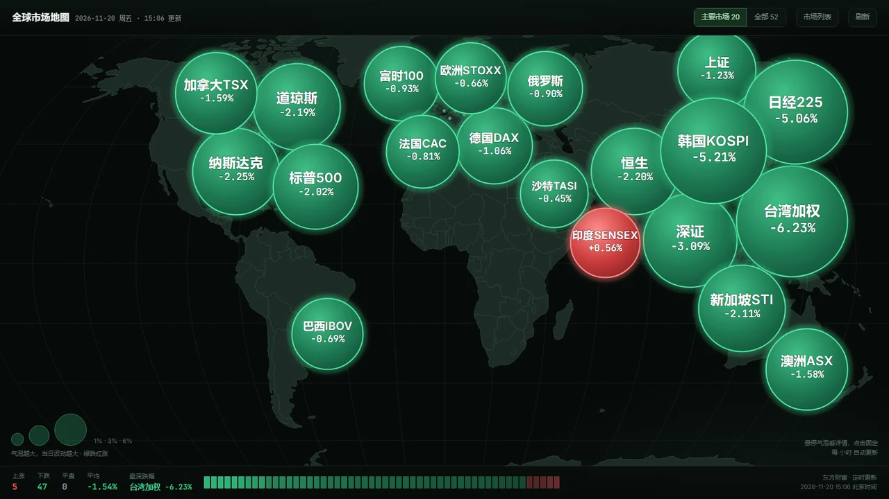

# 全球市场地图



一张暗色世界地图看全球主要股指的当日涨跌：**气泡越大波动越大，绿跌红涨**，悬停读详情。覆盖 52 个指数、5 个大洲。

- 主要市场视图：20 个核心指数，气泡带名称与涨跌幅
- 全部视图：52 个市场缩成小圆点，悬停/点开看详情，避免气泡糊成一片
- 市场列表：按涨跌幅排序、按大洲分组，点击定位
- 数据每小时自动更新（GitHub Actions）

## 数据

| 项 | 说明 |
| --- | --- |
| 来源 | 东方财富全球指数行情（`push2.eastmoney.com`） |
| 快照 | `public/data/snapshot.json`，由 `scripts/fetch-data.mjs` 生成 |
| 频率 | GitHub Actions `cron: 5 * * * *`，每小时第 5 分钟；内容有变化才提交 |
| 时区 | 所有时间按北京时间（UTC+8）展示 |

页面读取的是**已提交的快照**，不直连行情接口 —— 所以站点在没有网络、没有后端的情况下也能完整渲染，数据可回溯到具体一次抓取。

## 本地运行

```bash
npm install
npm run fetch     # 抓一次最新行情，写入 public/data/snapshot.json
npm run dev       # http://localhost:5173
npm run build     # 产物在 dist/
```

生成/更新地图底图（改了 `src/data/places.json` 的经纬度后需要跑）：

```bash
node scripts/gen-map.mjs
```

`src/data/geo.generated.ts` 是生成物，别手改。

## 目录

```
scripts/
  fetch-data.mjs      抓东财行情 → public/data/snapshot.json
  gen-map.mjs         world-atlas → 世界轮廓 path + 城市投影坐标
src/
  data/places.json    52 个市场的元数据（代码/名称/城市/经纬度/是否核心）
  data/geo.generated.ts
  lib/market.ts       类型、颜色、半径、格式化
  lib/layout.ts       气泡避让（同城多指数的斥力松弛）
  components/WorldMap.tsx     SVG 世界地图 + 气泡
  components/MarketPanel.tsx  列表侧栏 + 悬停详情卡
  App.tsx
.github/workflows/
  update.yml          定时抓数据并提交
  deploy.yml          构建并部署 GitHub Pages
```

## 统计口径

- 涨跌幅、点位、涨跌点数一律取自数据源原值，没有二次加工
- "平均"是 52 个指数涨跌幅的算术平均，不代表任何可投资组合
- 各交易所收盘时间不同，同一时刻图上混合了隔夜收盘价与盘中价，气泡详情里给出每个市场的实际报价时间

## 免责

数据来自公开行情接口，可能延迟或有误；仅供观察，不构成投资建议。
